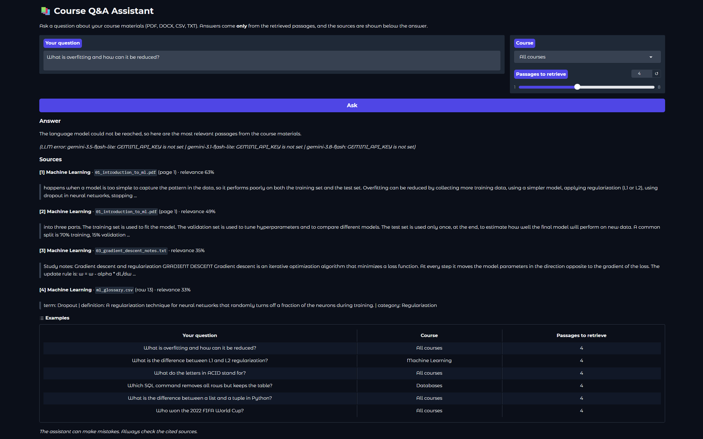
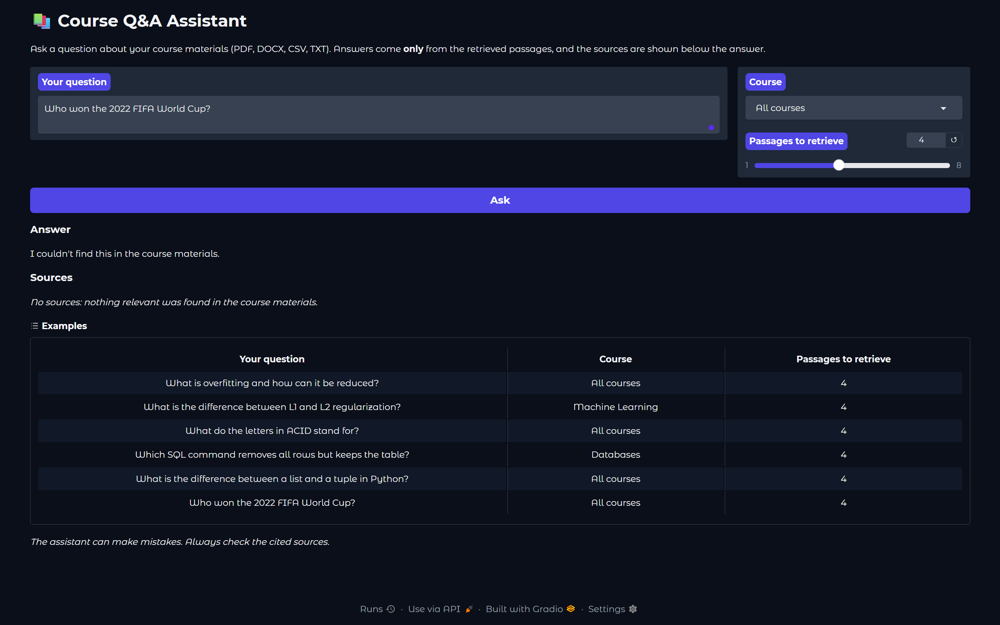
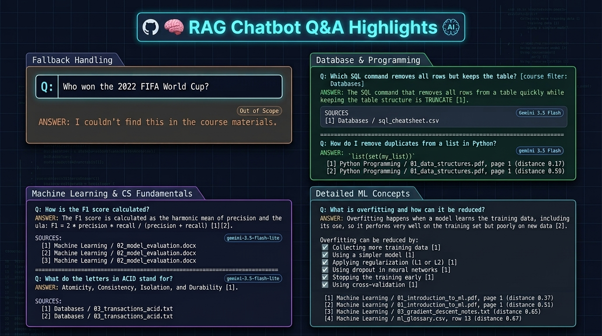
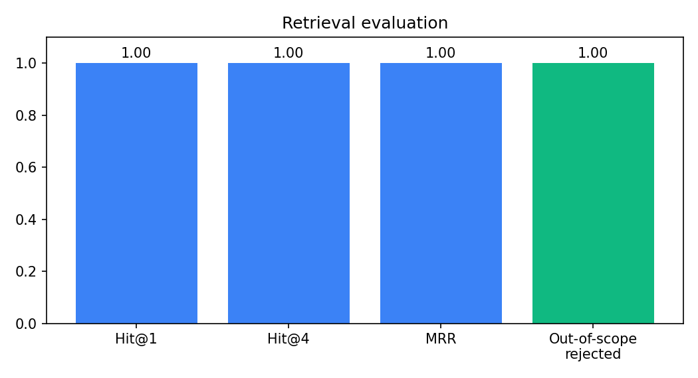

# 📚 Standard Course Q&A RAG System


A standard **Retrieval-Augmented Generation (RAG)** system that answers student questions **only from course materials** in different file types (**PDF, DOCX, CSV, TXT**) and shows the sources of every answer. Course files are cleaned, split into chunks, embedded with sentence-transformers, stored in **ChromaDB**, and retrieved for each question. **Gemini** then writes an answer from the retrieved passages. The system is deployed as a **Gradio** web app.

---

## 🌐 Links

- 📓 **Notebook on Kaggle:** [standard-course-q-a-rag-system](https://www.kaggle.com/code/abdelazizelshourbgy/standard-course-q-a-rag-system)

## 📸 Demo

**Web app (Gradio)**

https://github.com/user-attachments/assets/9168ffc2-c6ed-4de9-94b6-b95c52a048df

<p align="center">
  
  
</p>

**Notebook outputs**

<p align="center">
  
</p>

---

## ✨ Features

- Reads **4 file types** (PDF, DOCX, CSV, TXT) from several courses
- **Source attribution**: every answer lists the course, file and page or row number
- Answers **only from retrieved passages**; unrelated questions are refused instead of answered from the LLM's own knowledge
- **Course filter** to search a single course
- Graceful fallback: if the LLM is unavailable (for example the free quota is used up), the app still shows the retrieved passages
- Settings (chunk size, models, threshold) can be changed with environment variables

## 🗂️ Course materials

The repository includes **sample materials for 3 courses**, written for testing the pipeline: *Machine Learning*, *Databases* and *Python Programming*. Each course has one PDF, one DOCX, one TXT and one CSV file (12 files in total), generated by `create_sample_data.py`.

| Course | PDF | DOCX | TXT | CSV | Chunks |
|---|---|---|---|---|---|
| Machine Learning | 5 | 4 | 3 | 12 | 24 |
| Databases | 4 | 3 | 4 | 12 | 23 |
| Python Programming | 3 | 3 | 4 | 10 | 20 |
| **Total** | | | | | **67** |

To use your own course files, put them in `data/courses/<Course_Name>/` (one folder per course, any mix of the 4 file types) and run the app again.

## 🧪 Method

```
course files -> extract text -> clean -> chunk -> embeddings -> ChromaDB -> retriever -> Gemini -> answer + sources
```

| Step | Details |
|---|---|
| Extract | PDF: one unit per page (`pypdf`). DOCX: paragraphs and tables in document order (`python-docx`). CSV: one unit per row, written as `column: value` (`pandas`). TXT: whole file |
| Clean | Remove control characters, re-join words split at line ends, normalize whitespace |
| Chunk | About 800 characters with 150 characters of overlap. Paragraphs are kept together, long paragraphs are split into sentences. Each chunk keeps its metadata (course, file, type, page or row) |
| Embed | `sentence-transformers/all-MiniLM-L6-v2` (normalized vectors, runs on CPU) |
| Store | ChromaDB with cosine distance |
| Retrieve | Top 4 chunks, optional filter by course. Chunks with cosine distance above **0.75** are dropped; if nothing is left, the system answers that it could not find the answer, without calling the LLM |
| Generate | Gemini (`gemini-3.5-flash-lite` was used in the notebook run, with other models as fallbacks). The prompt allows only the numbered excerpts, requires citations like `[1]`, and defines the exact sentence to use when the answer is missing |

---

## 📊 Results

Evaluation uses a small test set written by hand for the sample materials: **15 in-scope questions** (each with the file or files that contain the answer) and **4 out-of-scope questions** (for example "Who won the 2022 FIFA World Cup?").

### Retrieval (no LLM involved)

| Metric | Value |
|---|---|
| Hit@1 (correct file ranked first) | 1.00 |
| Hit@4 (correct file in the top 4) | 1.00 |
| MRR | 1.00 |
| Out-of-scope questions rejected by the threshold | 4 / 4 |

Top-1 cosine distance: **0.186 to 0.661** for in-scope questions and **0.849 to 0.919** for out-of-scope questions. The threshold of 0.75 sits between the two ranges.



### Example answers

| Question | Answer (summary) | Sources |
|---|---|---|
| What is overfitting and how can it be reduced? | Definition plus six ways to reduce it | `01_introduction_to_ml.pdf` (page 1) |
| What do the letters in ACID stand for? | Atomicity, Consistency, Isolation, Durability | `03_transactions_acid.txt` |
| Which SQL command removes all rows but keeps the table? (course filter: Databases) | `TRUNCATE` | `sql_cheatsheet.csv` (row 6) |
| How do I remove duplicates from a list in Python? | Convert to a set, or use `dict.fromkeys` to keep the order | `python_faq.csv` (row 4), `01_data_structures.pdf` |
| Who won the 2022 FIFA World Cup? | "I couldn't find this in the course materials." | none |

### Observations

- **CSV questions have the smallest distances** (about 0.17 to 0.29) because each row is a short, focused chunk. Questions answered from PDF and DOCX chunks have larger distances (about 0.37 to 0.66), because those chunks are longer and cover several ideas.
- Two correct answers were retrieved with relatively large distances (F1 score: 0.60, ACID: 0.66), and some supporting passages came in at 0.74, close to the 0.75 threshold. The margin between relevant and irrelevant passages is therefore smaller than the perfect retrieval scores suggest.
- The "sources" shown in the app are the passages given to the LLM as context. The LLM does not always cite all of them, so check the numbers in the answer.

---

## 📁 Project structure

```
course-qa-rag/
├── standard-course-q-a-rag-system.ipynb   # notebook: pipeline, demo and evaluation
├── rag_core.py                    # the RAG pipeline (used by the app)
├── app.py                         # Gradio app
├── create_sample_data.py          # generates the sample course files
├── requirements.txt
├── requirements-dev.txt           # adds reportlab, only for create_sample_data.py
├── data/courses/                  # sample course materials (one folder per course)
│   ├── Machine_Learning/
│   ├── Databases/
│   └── Python_Programming/
├── assets/                        # screenshots and charts
├── LICENSE
└── README.md
```

## 🚀 Run locally

You need a free Gemini API key from [Google AI Studio](https://aistudio.google.com/apikey).

```bash
git clone https://github.com/AbdelazizElshourbgy-ui/course-qa-rag.git
cd course-qa-rag

python -m venv venv
venv\Scripts\activate        # Windows
# source venv/bin/activate   # macOS / Linux

pip install -r requirements.txt
```

Set the key and start the app:

```bash
# Windows PowerShell
$env:GEMINI_API_KEY="your_key"
# macOS / Linux
# export GEMINI_API_KEY="your_key"

python app.py
```

Open the local address printed in the terminal (usually `http://127.0.0.1:7860`). The first run downloads the embedding model and builds the index from `data/courses`. The app runs on CPU.

Useful settings (environment variables): `GEMINI_MODEL` (comma-separated list of models, tried in order), `EMBED_MODEL`, `CHUNK_SIZE`, `CHUNK_OVERLAP`, `TOP_K`, `MAX_DISTANCE`, `DATA_DIR`. Gemini model names change often; check the models available for your key in the notebook.

## 🔁 Reproduce the notebook on Kaggle

1. Import the notebook and turn on **Internet** in the settings.
2. Add your Gemini key as a Kaggle secret named `GEMINI_API_KEY` (`Add-ons > Secrets`).
3. Upload the `data/courses` folder as a Kaggle dataset and add it as an input. The notebook finds it automatically.
4. Run the cells. No GPU is needed.

## 🌍 Deployment

The app is a standard Gradio app, so it can be hosted anywhere that runs Python.

- **Local:** run `python app.py` as shown above.
- **Temporary public link:** set `GRADIO_SHARE=1` before running (`$env:GRADIO_SHARE="1"` in PowerShell). Gradio prints a public link that works only while the app is running on your computer. Anyone with the link uses your Gemini quota, so share it only for short demos.
- **Hugging Face Spaces:** the repository is Space-ready (`app.py`, `rag_core.py`, `requirements.txt` and `data/courses`, with `GEMINI_API_KEY` added as a Space secret). At the time of writing, free Hugging Face accounts can no longer create CPU-based Gradio Spaces (they need a PRO plan, or one of the 2 free ZeroGPU slots), so this project is not hosted there.

## ⚠️ Limitations

- The evaluation is small (15 + 4 questions) and uses sample materials whose wording is close to the questions, so the perfect retrieval scores are optimistic and do not predict the results on real, messier course files.
- The relevance threshold (0.75) was chosen from this small test set and should be re-checked for new materials.
- Scanned PDFs (images) are not supported because there is no OCR.
- Chunking is character-based and the default embedding model is English only. For Arabic materials or questions, use a multilingual model such as `paraphrase-multilingual-MiniLM-L12-v2`.
- The LLM can still make mistakes even with strict instructions, so the cited sources should be checked.
- The Gemini free tier has low rate limits, and its free-tier content may be used by Google to improve its products, so avoid private materials.

## 🔮 Future work

- Hybrid search (BM25 + embeddings) and a re-ranker
- OCR for scanned files
- Conversation memory for follow-up questions
- Automatic answer evaluation (faithfulness and citation accuracy) on a larger, real test set
- Upload new files from the web interface

## 🛠️ Tech stack

Python · sentence-transformers · ChromaDB · Google Gemini API (`google-genai`) · Gradio · pypdf · python-docx · pandas · Matplotlib · Kaggle

## 👤 Author

**Abdelaziz Elshourbgy**

GitHub: [@AbdelazizElshourbgy-ui](https://github.com/AbdelazizElshourbgy-ui) · LinkedIn: [Abdelaziz Elshourbgy](https://www.linkedin.com/in/abdelaziz-elshourbgy-b126a83a2/)

## 📄 License

Code released under the [MIT License](LICENSE). The sample course materials were written for this project.
